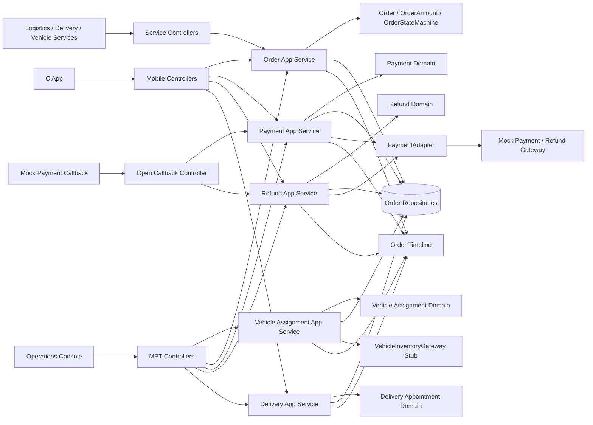
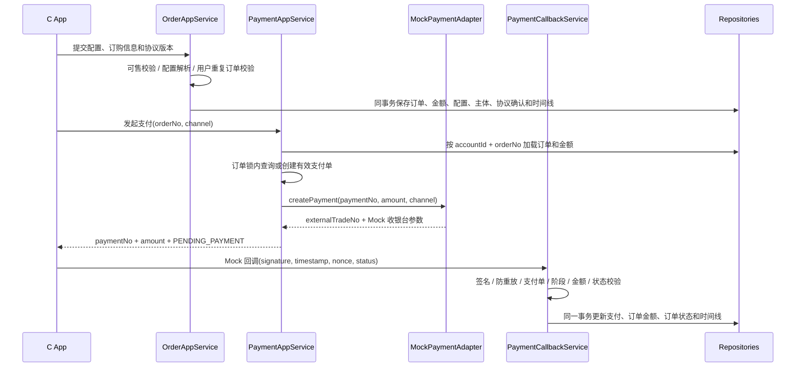
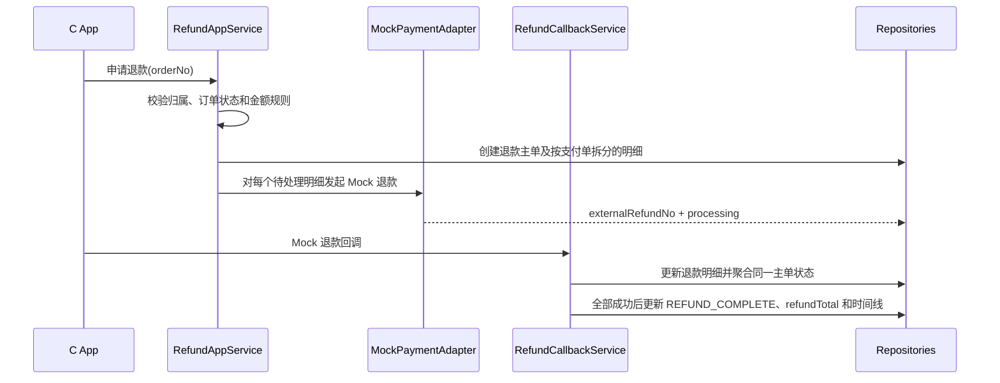

# C App Vehicle Purchase - Design

## 1. Architecture Overview



订单聚合是状态与金额事实的入口；支付、补款、退款通过各自领域对象记录业务事实，并通过应用服务在同一事务内推进订单。Controller 只处理 VO、鉴权和参数转换，Domain 不依赖 Spring、MyBatis 或 PO。

MPT 侧只读：运营后台通过应用服务的无 accountId 变体查询时间线、支付/补款、退款、协议确认和交付预约，只读端点不调用网关、不推进状态、不追加时间线。

## 2. Tech Stack & Decisions

| Decision | Choice | Alternatives | Rationale |
|---|---|---|---|
| 订单归属 | `vso_order` JOIN `vso_order_party`，以 `order_user + accountId` 过滤 | Controller 内存过滤；信任请求 accountId | 用户条件必须下沉 SQL，账号只取 SecurityContext |
| 订单金额 | `vso_order_amount` 保存下单价格快照，支付/退款仅累计事实 | 每次按销售车型最低价重算 | 避免 Variant 串价及历史价格漂移 |
| 支付实现 | 可替换 `PaymentAdapter` + Mock 实现，终态由签名回调驱动 | 查询固定返回 PAID；Controller 直接 `order.pay()` | Mock 不绕过真实支付状态和幂等逻辑 |
| 支付并发 | 订单号分布式锁 + 查询有效支付单 | 依赖前端防重；新增数据库状态生成列 | 与现有 OrderLockService 对齐，支持返回已有支付单 |
| 支付/退款回调 | 复用 HMAC-SHA256、timestamp、nonce 和幂等键 | 关闭签名验证；只按 paymentNo 幂等 | 防止伪造、重放和冲突回调 |
| 自动锁单 | 每分钟扫描数据库中到期 `DOWN_PAYMENT_PAID` 订单 | 只依赖 Redis 超时任务 | 服务重启或任务丢失后仍可按持久化支付时间补偿 |
| 退款与原支付关系 | 退款主单 + 退款明细，按原支付单拆分金额 | 一个退款主单只关联最后一笔支付 | 支持意向金与补款等多笔支付，保持金额可追踪 |
| 协议模板与确认 | 新协议模板表和独立订单确认表 | 复用 vso_contract；硬编码协议 | 避免 contract 唯一键冲突并保存完整确认快照 |
| 交付预约 | 复用现有预约及交付记录表，订单锁保证一个有效预约 | 新增重复预约模型 | 现有字段已覆盖需求 |
| 时间线 | 独立 Domain/Repository，按订单追加事件 | Controller 组装假进度；覆盖旧记录 | 保留完整、可审计的状态历史 |
| 对象分层 | 新增 Payment、Refund、DeliveryAppointment 等 Domain 与 Converter | Application 直接创建/返回 PO | 遵守项目分层约束 |
| MPT 运营视图 | 只读，复用应用服务无 accountId 变体；订单域路径统一业务 orderId | MPT Controller 自拼查询；复用主键 id 作路径参数 | 运营需要核对全链路事实，但状态事实仍只能由 C 端用例与签名回调推进 |
| MPT 列表分页 | `startPage()` + 数据库分页 | 全量查询后内存截断 | 与 INV-001 及需求 §4 的数据库分页约束一致 |
| 占位端点 | 删除没有实现且无契约的端点 | 保留返回空 PageResult | 空实现会被前端当成“无数据”，掩盖真实缺陷 |

## 3. Data Model

### 3.1 订单金额语义

| 字段 | 意向金订单 | 直接定金订单 | 后续维护 |
|---|---|---|---|
| vehiclePrice | 选中 Variant 价格 | 选中 Variant 价格 | 改配时按新版本更新 |
| optionPrice | 选中 Option 价格合计 | 选中 Option 价格合计 | 改配时按新版本更新 |
| dealPriceTotal | vehiclePrice + optionPrice | 同左 | 调用 OrderAmount.recalculate |
| depositAmount | 选中 Variant 意向金价格 | 0 | 下单后作为转定金计算基准 |
| downPaymentAmount | 选中 Variant 定金价格 | 选中 Variant 定金价格 | 下单后作为定金应付基准 |
| paidTotal | 初始 0 | 初始 0 | 支付成功时按支付单幂等累计 |
| refundTotal | 初始 0 | 初始 0 | 退款全部成功时按退款主单幂等累计 |
| upgradedFromSmall | 初始 false | false | 转定金时按 paidTotal > downPaymentAmount 计算并持久化 |

`EARNEST_MONEY` 和 `DOWN_PAYMENT` 支付金额必须读取上述订单金额快照，不得调用销售车型最低价方法。

### 3.2 V1.39.0 数据变更

新增迁移：`V1.39.0__complete_c_app_purchase_flow.sql`。

#### A. 订单主表补充定金支付时间

```sql
ALTER TABLE vso_order
    ADD COLUMN down_payment_time TIMESTAMP NULL
        COMMENT '定金支付完成或意向金转定金完成时间' AFTER lock_time;

CREATE INDEX idx_order_auto_lock
    ON vso_order (order_state, down_payment_time, row_valid);
```

直接定金支付、补差转定金及无差额转定金成功时写入该字段。自动锁单只读取此持久化时间。

#### B. 订单金额表补充升级标记

```sql
ALTER TABLE vso_order_amount
    ADD COLUMN upgraded_from_small TINYINT NOT NULL DEFAULT 0
        COMMENT '是否由小定升级且存在超额金额' AFTER calculation_version;
```

同步修改 `OrderAmountPo`、Converter 和 Repository 读写。

#### C. 新增购车协议模板表

`vso_purchase_agreement`：

| 字段 | 类型/约束 | 说明 |
|---|---|---|
| id | BIGINT PK | 主键 |
| agreement_id | VARCHAR(64) UNIQUE | 协议业务 ID |
| agreement_code | VARCHAR(64) | 协议代码 |
| sale_model_code | VARCHAR(64) DEFAULT `GLOBAL` | 车型专属或全局协议 |
| version_no | INT | 版本号 |
| title / intro / detail | VARCHAR/TEXT | 展示内容 |
| agreement_status | VARCHAR(32) | draft/active/off_shelf |
| effective_from / effective_to | TIMESTAMP NULL | 有效期 |
| create_time / modify_time / row_version / row_valid | 现有通用字段 | 审计与有效标记 |

唯一键：`(sale_model_code, agreement_code, version_no, row_valid)`。  
查询顺序：车型专属有效协议优先，其次 `GLOBAL`；同代码取当前有效最高版本。

订单确认使用独立的 `vso_order_agreement_confirmation` 表。

不得直接复用 `vso_contract`，因为其现有唯一键 `(order_id, contract_type, version_no, row_valid)` 会阻止同一订单确认多份同版本协议。确认记录保存 agreementId、agreementCode、versionNo、标题、简介、详情和确认时间快照，唯一键为 `(order_id, agreement_id, row_valid)`。

下单请求中的每个 `agreementCode + versionNo` 必须与当前有效协议匹配；缺少必确认协议时整单回滚。

#### D. 新增退款明细表

`vso_refund_item`：

| 字段 | 说明 |
|---|---|
| refund_item_id | 退款明细业务 ID，唯一 |
| refund_id | 关联退款主单业务 ID |
| payment_id / payment_no | 原支付事实 |
| refund_amount | 分摊到原支付单的退款金额 |
| refund_status | pending/processing/completed/failed |
| external_refund_no | Mock 外部退款单号 |
| fail_reason | 失败原因 |
| refund_time | 明细完成时间 |
| create_time / modify_time / row_version / row_valid | 通用字段 |

索引：`(refund_id, refund_status)`、`(payment_id, refund_status)`。

退款主单按支付成功时间正序分摊退款金额；所有明细完成才完成主单，任一明细失败则主单失败，重试仅处理失败明细。

#### E. 用户订单查询索引

```sql
CREATE INDEX idx_order_party_user_role
    ON vso_order_party (user_id, party_role, row_valid, order_id);
```

### 3.3 状态持久化补充

- `OrderPo`、OrderMapper 和 OrderPoConverter 补充 `downPaymentTime`。
- `OrderRepository.findByOrderNoAndAccountId` 使用订单与 `order_user` 关系 JOIN，不再忽略 accountId。
- `OrderRepository.search` 接收 accountId；MPT 查询不传，C 端必传。
- `OrderRepository.findByAccountId` 替代当前 UnsupportedOperationException。
- 支付、退款、预约领域 Repository 使用 Domain 类型，Infrastructure 通过 Converter 映射现有 PO。

## 4. Core Flows

### 4.1 下单与支付



支付状态处理：

| 回调状态 | 支付单 | 订单 |
|---|---|---|
| PAID | PAID，保存 externalTradeNo/payTime | 意向金或定金已支付，累计 paidTotal |
| PROCESSING | PROCESSING | 保持原待支付状态 |
| PAYMENT_FAILED | PAYMENT_FAILED + failReason | 保持原待支付状态 |
| CANCELLED | CANCELLED | 保持原待支付状态 |

支付单已有终态时：

- 相同幂等键、相同结果：返回已处理，不重复更新。
- 不同幂等键但相同终态：确认事实一致后幂等返回。
- 与已有终态冲突：返回 PAYMENT_CONFLICT，不覆盖原事实。

直接定金支付或转定金完成时写入 `downPaymentTime`。取消待支付订单时关闭有效支付单并取消支付超时任务。

### 4.2 意向金转定金

```text
difference = orderAmount.downPaymentAmount - orderAmount.depositAmount
```

- 差额 > 0：订单锁内查询现有 `earnest_to_down + pending` 补款；不存在才创建。补款支付单与 `supplementaryNo` 关联。
- 补款成功：补款置 completed，累计 paidTotal，订单转 FORMAL/DOWN_PAYMENT_PAID，写 downPaymentTime。
- 差额 <= 0：直接完成相同订单转换，不创建补款。
- `upgradedFromSmall = paidTotal > downPaymentAmount`。
- 已转换订单重复请求返回当前结果；支付回调重复到达不得再次累计或转换。

### 4.3 退款



退款规则：

- 未锁单普通订单：refundAmount = paidTotal，fee = 0。
- `ARRANGE_PRODUCTION`：fee = max(paidTotal × 5%, 500)，refundAmount = paidTotal - fee。
- `upgradedFromSmall = true` 且未锁单：refundAmount = paidTotal - downPaymentAmount，fee = paidTotal - refundAmount。
- 金额必须大于 0，否则拒绝申请。
- 失败后订单保持 `REFUND_APPLY`；重试只重新发起 failed 明细，不重复创建主单。

### 4.4 手动与自动锁单

- 手动锁单和自动锁单均进入同一 `OrderAppService.lock` 用例和订单锁。
- 仅允许 `DOWN_PAYMENT_PAID -> ARRANGE_PRODUCTION`。
- 自动任务每分钟查询：

```text
order_state = DOWN_PAYMENT_PAID
AND down_payment_time <= currentTime - 48 hours
AND row_valid = 1
```

- 已锁单订单再次执行时幂等返回；不得重复追加成功锁单时间线。
- 退款、取消或其他状态订单即使存在历史 downPaymentTime 也不会被扫描。

### 4.5 配车、发运、交付与激活

合法主链：

```text
ARRANGE_PRODUCTION
  -> ALLOCATION_VEHICLE
  -> APPLY_TRANSPORT
  -> PREPARE_TRANSPORT
  -> TRANSPORTING
  -> PREPARE_DELIVER
  -> DELIVERED
  -> ACTIVATED
```

- MPT `assignVehicle` 统一调用 `VehicleAssignmentAppService.assignVehicle`，不再走只保存 VIN 的旧方法。
- `applyTransport` 必须写申请人、申请时间及 `APPLY_TRANSPORT`。
- 每次状态变更使用 OrderStateMachine 校验并追加时间线。
- `delivered` 同事务创建交付记录、完成有效预约并更新订单。
- `activate` 增加 `DELIVERED -> ACTIVATED` 校验，不允许从任意状态直接激活。
- 取消/关闭配车订单时复用统一 VIN 释放逻辑。

### 4.6 订单详情与时间线

订单详情由以下事实按需组装：

- Order、OrderAmount、OrderVehicleSnapshot
- OrderParty、OrderAssignment
- Payment、SupplementaryPayment、Refund/RefundItem
- VehicleAssignment
- DeliveryAppointment、DeliveryRecord
- OrderTimeline

未发生环节返回 `NOT_STARTED` 或空业务对象，不合成业务单号和时间。时间线按 `eventTime ASC, id ASC` 查询。

运营（MPT）复用同一时间线查询与字段，额外要求：`OrderTimeline` 已持久化 `operatorId`，`OrderTimelineResult` MUST 同时输出 `operatorId`、`operatorRole`、`operateSource`，不得只输出角色。MPT 读到的“谁在哪个终端做了什么”必须来自持久化事实，不得在 Controller 由当前登录人拼装。

## 5. API Contracts

所有 Mobile/MPT Controller 使用 `ApiResponse`；账号仅来自 SecurityContext。时间字段继续遵守 CR-001 时间契约。

### 5.1 车型与协议

| Method / Path | Request | Response / 说明 |
|---|---|---|
| GET `/api/mobile/saleModel/v1/purchaseAgreements/{saleModelCode}` | path: saleModelCode | `List<PurchaseAgreementVo>`：agreementCode、versionNo、title、intro、detail |
| 现有车型、configurator、quote、purchaseBenefits | 不变 | 保持现有契约 |
| GET `/api/mpt/vso/v1/{orderId}/agreements` | path: orderId | `List<PurchaseAgreementResult>`：订单确认快照，定义见 §5.4.2 |

订单确认快照查询本期仅对 MPT 开放；C 端本期不提供该查询，若后续开放 MUST 补 `orderId + accountId` 归属校验（INV-001），不得直接暴露 `PurchaseAgreementAppService.listConfirmations`。

### 5.2 下单、支付、转定金与退款

| Method / Path | 关键 Request | 关键 Response / 行为 |
|---|---|---|
| POST `/api/mobile/vso/v1/action/earnestMoneyOrder` | saleModelCode、modelCode、variantCode、optionCodes、licenseCityCode、agreementConfirmations | 订单号、订单快照意向金、渠道、expireTime |
| POST `/api/mobile/vso/v1/action/downPaymentOrder` | 同上 + customerType、paymentMethod、订购人、购买计划、门店 | 订单号、订单快照定金、渠道、expireTime |
| POST `/action/initiatePayment` | orderNo、paymentChannel | paymentNo、金额、状态、Mock paymentMerchant/paymentReference |
| GET `/payment/{paymentNo}` | path: paymentNo | 支付单、订单号、阶段、金额、渠道、状态、payTime、failReason |
| GET `/order/{orderNo}/payments` | path: orderNo | 本人订单支付记录，创建时间倒序 |
| POST `/order/action/earnestMoneyToDownPayment` | orderNo + 购车补充信息 | 当前订单类型/状态及已有或新补款任务 |
| GET `/supplement/list?orderNo=` | orderNo | 本人补款任务 |
| POST `/supplement/initiatePayment` | supplementaryNo、paymentChannel | 补款支付单及 Mock 收银台参数 |
| POST `/order/action/requestRefund` | orderNo | refundNo、金额、手续费、pending 状态 |
| GET `/refund/{refundNo}` | refundNo | 主单及各支付明细的退款进度 |
| POST `/refund/action/retry` | refundNo | 当前退款主单；仅重试 failed 明细 |
| POST `/api/open/vsoCallback/v1/payment` | 支付字段 + timestamp/nonce + X-Signature | 成功、重复或明确失败 |
| POST `/api/open/vsoCallback/v1/refund` | refundNo、refundItemNo、金额、状态、时间 + 签名 | 成功、重复或明确失败 |

直接定金下单 VO 增加 `modelCode`、`variantCode`、`optionCodes` 和协议确认，不再依赖未映射的 `saleModelConfigType`。保留 `orderNo` 作为旧客户端从意向金订单进入转定金的兼容入口，内部复用 US-005 用例。

移除公开直接改支付状态的 `POST /order/action/pay`；支付成功只能由支付回调用例推进。`/{orderId}/cancel` 统一收敛到 `/order/action/cancel`。

### 5.3 锁单、进度与交付预约

| Method / Path | Request | Response / 行为 |
|---|---|---|
| POST `/order/action/lock` | orderNo | 手动锁单；重复请求幂等 |
| GET `/order/{orderNo}` | orderNo | 本人订单完整详情 |
| GET `/order/{orderNo}/timeline` | orderNo | 本人订单时间线，时间正序 |
| POST `/deliveryAppointment/action/create` | orderNo、appointmentTime、storeCode、place | 预约单号及 booked 状态 |
| POST `/deliveryAppointment/action/modify` | appointmentNo、appointmentTime、storeCode、place、reason | 修改后预约 |
| POST `/deliveryAppointment/action/cancel` | appointmentNo、reason | cancelled 状态 |
| GET `/deliveryAppointment/{orderNo}` | orderNo | 当前有效预约及最近交付记录 |

预约联系人手机号等非必要敏感字段本期不新增采集；现有加密字段保持为空。

### 5.4 MPT 与内部服务

MPT 侧只提供“运营只读视图 + 既有写动作”。写动作仅限审核、锁单、关闭、配车、换绑/解绑、发运申请、交付人员分配；MPT MUST NOT 新增任何修改订单金额、支付或退款状态的端点，C 端事实只能由 C 端用例和签名回调推进。

#### 5.4.1 既有写动作（保持路径）

- 保持 `/api/mpt/vso/v1/action/assignVehicle`、`/action/reassignVehicle`、`/action/unbindVehicle`、`/action/applyTransport`、`/action/assignDeliveryPerson`，修正业务实现。
- 新增运营改配提交 `POST /api/mpt/vso/v1/{orderId}/modifyConfig`（US-012）：复用 C 端 `modifyConfig` 的配置解析、快照版本递增、价格差额补/退与领域事件，C 端与 MPT 共用同一实现，禁止各写一份；锁内重新加载订单，时间线 `operateSource=mpt`。
- `applyTransport` 从当前管理端上下文取得 operatorId/operatorName。
- MPT 写动作的时间线 MUST 记录真实 `operatorId`/`operatorName` 与 `operateSource=mpt`，不得写死 `system`。
- 保持 `/api/service/order/v1/order/action/prepareTransport|transporting|prepareDelivery|delivered|activate`。
- 修正 `VsoOrderService` Feign base path 与上述 Controller 契约一致，并补齐方法 HTTP 注解。

#### 5.4.2 运营只读查询（CR-002 原地修订新增）

| Method / Path | Request | Response / 说明 |
|---|---|---|
| GET `/api/mpt/vso/v1/{orderId}` | path: orderId（业务订单 ID） | `VehicleSaleOrderMpt` 订单完整详情，复用 `OrderAppService.getById` |
| GET `/api/mpt/vso/v1/{orderId}/timeline` | 同上 | `List<OrderTimelineResult>`，`eventTime ASC`；必须含 operatorId、operatorRole、operateSource、relatedDocNo、failReason |
| GET `/api/mpt/vso/v1/{orderId}/payments` | 同上 | `List<PaymentResult>`：paymentStage（EARNEST_MONEY/DOWN_PAYMENT/SUPPLEMENT）、金额、状态、渠道、payTime、failReason |
| GET `/api/mpt/vso/v1/{orderId}/supplements` | 同上 | `List<SupplementaryPaymentVo>`：补款任务、场景、金额、状态、配置版本 |
| GET `/api/mpt/vso/v1/{orderId}/refunds` | 同上 | `List<RefundResult>`：refundScene、refundAmount、refundFee、refundStatus、items 及 failReason |
| GET `/api/mpt/vso/v1/{orderId}/agreements` | 同上 | `List<PurchaseAgreementResult>`：确认快照 agreementCode/versionNo/title/intro/detail |
| GET `/api/mpt/vso/v1/{orderId}/delivery` | 同上 | `DeliveryAppointmentResult`：有效预约 + 交付记录；未预约返回 `null`，不得合成单号 |

契约约束：

1. 路径参数统一为业务 `orderId`（`vso_order.order_id`，String）。`orderNo` 只作为列表查询条件；MUST NOT 用主键 `id`，MUST NOT 使用 `Long` 或 `vehicleSaleOrderId` 之类与语义不符的参数名。
2. MPT 只读查询不做 C 端账号隔离（INV-001 仅约束 C 端），但 MUST 使用 MPT 权限点：查询类统一 `completeVehicle:order:info:query`；订单不存在返回 `ORDER_NOT_EXIST`。
3. 复用应用服务的无 accountId 变体，MUST NOT 在 Controller 内拼装 SQL 或绕过应用服务；`listConfirmations` 归属 MPT 语义，C 端使用前必须补归属校验。
4. 只读端点 MUST NOT 触发支付/退款网关调用、状态推进或时间线追加。
5. 退款手续费可核对：`refundAmount + refundFee` 即申请时 `paidTotal`；`refundScene=arrange_production` MUST 满足 `refundFee = max((refundAmount+refundFee) × 5%, 500)`，未锁单场景 `refundFee=0`，`upgradedFromSmall` 场景 `refundFee = paidTotal - downPaymentAmount`。因此退款查询 MUST 同时返回 `refundScene`，不新增数据库字段。
6. 交付人员分配列表 `GET /api/mpt/vso/v1/listWithoutDeliveryPerson` MUST 批量带出 `appointmentNo`、`appointmentTime`、`appointmentStatus`、`vehicleVin`，一次批量查询完成，禁止按订单逐条查询（N+1）。
7. MPT 订单列表端点 MUST 走 `startPage()` 数据库分页；`PageResult.total` 与页大小来自分页插件，MUST NOT 返回全量后在内存截断。仓储层转换 MUST 保留 `com.github.pagehelper.Page` 实例（否则 total 退化为当前页条数）。列表时间范围 MUST 来自 `BaseRequest.params[beginTime]`/`params[endTime]`，MUST NOT 用 `instanceof Map` 之类的无效取参。
8. `VehicleSaleOrderMpt.id`（数据库主键）仅用于展示与排查，MUST NOT 作为任何路由或请求参数；前端一律使用 `orderId`。
9. MUST NOT 保留未实现且无契约的占位端点：`GET /api/mpt/vso/v1`（与 `/list` 语义重复）与本 CR 未定义的 `GET /api/mpt/vso/v1/vehicleAssignment/list` 删除；后续需要配车记录列表时另按新 CR 定义查询与分页契约。
10. MPT 写动作 MUST 使用安全上下文中的操作人（`SecurityUtils` / `MptAccount`），MUST NOT 以 `X-Operator-Id` 请求头充当操作人，也 MUST NOT 用 `catch (Exception)` 把业务异常统一转成“操作失败”；业务异常交由统一异常处理返回错误码。写动作的细粒度权限码需与权限中心对齐后另行配置，本期不新增猜测性权限码（避免前端 403）。

##### 5.4.3 运营字段、交付人员列表与写动作权限（CR-002 原地修订补充）

**协议后台管理**：`GET /api/mpt/vso/v1/purchaseAgreement/list` MUST 返回 `PageResult` 并走 `startPage()` 数据库分页（仓储层保留 `Page` 元信息），不得返回裸数组；权限点 `completeVehicle:order:agreement:list|edit|remove` 分别对应 list / action/save / action/offShelf。

- 协议唯一键 `uk_purchase_agreement_version(sale_model_code, agreement_code, version_no, row_valid)` 冲突 MUST 转为业务错误 `201054 AGREEMENT_VERSION_CONFLICT`（保存前预校验 + `DuplicateKeyException` 兜底），不得向前端暴露数据库异常；更新同一条协议（同 agreementId 同版本）不得误判冲突。

**可改配列表与改配校验一致性**：`listModelConfigChangeable` 的订单状态范围 MUST 与改配校验共用唯一事实源 `OrderState#configModifiableStateValues()`（210/300/310），MUST NOT 在 Controller 或服务中各自硬编码状态集合。

**删除端点清理**：逻辑删除端点 `DELETE /api/mpt/vso/v1/{orderNo}` 与其权限点 `completeVehicle:order:info:remove` 已删除（原实现仅校验 CANCEL 后原样保存订单，不产生任何删除事实，易被误用为“可恢复删除”）；MPT 订单删除只保留物理删除 `DELETE /physical/{orderId}`，其余“删除”语义 MUST 走新 CR。

**字段映射**：MPT 订单 VO 的每个字段 MUST 由 `OrderListResult` / `OrderDetailResult` 承载并实际赋值，前端不做 `-` 兜底猜测。

- 直接映射：`saleCode←salesCode`、`modelConfigCode`/`buildConfigCode←configurationCode`、`orderTime`、`lockTime`、`downPaymentTime`、`deliveryVin`、`deliveryPersonId/Name`、`createTime`；详情另含 `orderType/orderSource`（+名称经字典富化）、`brandCode/brandName`、`saleModel/saleModelName`、`licenseCity`。
- 派生映射（不新增数据库字段）：`orderStateTime` ← 时间线最新事件时间；`earnestMoneyTime` ← 该订单成功支付单中意向金阶段的 `payTime`；`earnestMoneyAmount`/`downPaymentAmount` ← 订单金额快照 `depositAmount`/`downPaymentAmount`。
- 列表 MUST 用批量查询（`selectByOrderIds`/`selectSuccessfulByOrderIds`/`selectLatestEventTimeByOrderIds`/`selectBookedByOrderIds`），禁止按订单逐条查询。
- 交付门店名称：组织服务仅提供 `getByCode` 单条接口，列表 MUST 按 `storeCode` 去重后逐个获取（N 行 → 不同门店数），禁止逐行远程调用；真正的批量接口需组织服务侧另立 CR。
- 交付人员未交付订单数 MUST 用一次批量统计（`GROUP BY delivery_person_id`，`delivery_finish_time IS NULL`），禁止逐个 `count`。
- 明确不输出：`id`（数据库主键，仅排查，禁止作为路由参数）与 `orderPersonPhone`/`orderPersonId`（`vso_order_party` 加密字段，本期隐私设计不输出）。二者在前端保持空值，不得以明文回填。
  - `VehicleSaleOrderMpt.id` 标记 `@Deprecated`，恒为 null；不给列表/详情补主键映射，避免把数据库主键引入领域对象与前端请求。
  - 订单联系人手机号/证件号归入 O-009：MPT 明文展示与解密服务另行设计，本期不补映射。
- 只读详情 MUST NOT 因历史金额快照缺失而失败：金额字段留空并记录告警，供人工修复。

**交付中心人员列表**：`GET /listDeliveryCenterStaff` MUST 返回真实人员，数据源为组织服务 `OrgDealershipStaffService.searchPage(dealershipCode, pageNum, pageSize)`（远程分页，不使用本地 `startPage()`），`notDeliveryOrderCount` 按交付人员统计未交付订单数；组织服务无返回时返回空分页，不得抛错。

**写动作权限码**（需在权限中心登记后生效，未登记时前端会收到 403）：

| 动作 | 权限点 |
|---|---|
| `action/assignDeliveryPerson` | `completeVehicle:order:assignDeliveryPerson:assign` |
| `action/assignVehicle` | `completeVehicle:order:assignVehicle:assign` |
| `action/reassignVehicle` | `completeVehicle:order:assignVehicle:reassign` |
| `action/unbindVehicle` | `completeVehicle:order:assignVehicle:unbind` |
| `action/applyTransport` | `completeVehicle:order:transport:apply` |
| `{orderId}/audit/pass|reject|resubmit` | `completeVehicle:order:info:audit` |
| `{orderId}/lock` | `completeVehicle:order:info:lock` |
| `{orderId}/close` | `completeVehicle:order:info:close` |
| `{orderId}/modifyConfig`（US-012 运营改配） | `completeVehicle:order:changeModel:edit` |
| `purchaseAgreement/list` | `completeVehicle:order:agreement:list` |
| `purchaseAgreement/action/save` | `completeVehicle:order:agreement:edit` |
| `purchaseAgreement/action/offShelf` | `completeVehicle:order:agreement:remove` |

## 5.5 新增错误码

| Code | 常量 | 场景 |
|---|---|---|
| 201039 | AGREEMENT_NOT_EXIST | 协议不存在、失效或版本不匹配 |
| 201040 | AGREEMENT_CONFIRMATION_REQUIRED | 必确认协议未提交 |
| 201041 | ORDER_ACCESS_DENIED | 订单不属于当前账号 |
| 201042 | REFUND_NOT_EXIST | 退款单不存在 |
| 201043 | REFUND_STATUS_NOT_ALLOWED | 当前退款状态不允许操作 |
| 201044 | REFUND_CONFLICT | 重复或冲突退款 |
| 201045 | DELIVERY_APPOINTMENT_NOT_EXIST | 预约不存在 |
| 201046 | DELIVERY_APPOINTMENT_CONFLICT | 已有有效预约 |
| 201047 | DELIVERY_APPOINTMENT_STATUS_NOT_ALLOWED | 预约状态不允许操作 |
| 201048 | CALLBACK_SIGNATURE_INVALID | 支付或退款回调签名/防重放失败 |
| 201049 | PAYMENT_AMOUNT_MISMATCH | 支付、补款或退款金额不一致 |

订单归属失败对外可统一表现为 ORDER_NOT_EXIST，避免泄露他人订单是否存在；日志记录 ORDER_ACCESS_DENIED 原因。

MPT 只读查询不新增错误码：订单不存在复用 ORDER_NOT_EXIST，权限不足由框架统一返回。

## 6. Coverage Mapping

| US-ID | Design Section | Note |
|---|---|---|
| US-001 | §3.2-C、§4.1、§5.1 | 协议版本查询与订单确认快照 |
| US-002 | §2、§3.2-E、§3.3、§5.2 | SQL 用户隔离及全部 C 端操作归属校验 |
| US-003 | §3.1、§3.2-A/B、§4.1、§5.2 | 两类下单、配置与金额快照 |
| US-004 | §2、§4.1、§5.2、§5.5 | Mock 支付、查询、异常、签名和幂等 |
| US-005 | §3.1、§4.2 | 差额补款、金额累计和转换幂等 |
| US-006 | §3.2-D、§4.3、§5.2 | 退款主从单、进度、失败重试 |
| US-007 | §3.2-A、§4.4 | 持久化时间及数据库补偿扫描 |
| US-008 | §4.5、§5.4 | 配车、发运、VIN 释放和合法状态链 |
| US-009 | §3、§4.5、§5.3 | 预约、交付记录和激活前置校验 |
| US-010 | §4.6、§5.3 | 完整详情及追加式时间线 |
| US-011 | §4.6、§5.4.2、§7.2 | MPT 运营只读视图、路径参数语义与空实现端点清理 |

## 7. Impact Analysis

### 7.1 主要改动范围

- Mobile：MobileSaleModelController、MobileVsoController、MobileSupplementPaymentController。
- MPT/Open/Service：MptVsoController、MptPurchaseAgreementController、OpenVsoCallbackController、ServiceOrderController、VsoOrderService。
- Application：OrderAppService、PaymentCallbackService；新增 Payment、Refund、Delivery、Agreement、Timeline 应用服务；为 MPT 只读查询补充 Payment/Refund/Delivery/Supplementary 的无 accountId 变体与列表查询（不改写事实）。
- Domain：Order、OrderAmount、OrderStateMachine、Payment、Refund、DeliveryAppointment、PurchaseAgreement、OrderTimeline 及 Repository；`OrderTimelineResult` 补 `operatorId` 输出。
- Infrastructure：相关 PO、Converter、Mapper、Repository、MockPaymentAdapter；交付人员分配列表增加预约/车辆批量查询。
- 数据库：V1.39.0 及 Notion 数据库文档、版本记录；US-011 不新增表或字段。

### 7.2 兼容与迁移

- 新增字段均有默认值，新增表不影响旧代码读取。
- 旧订单缺少金额快照时不得按当前销售策略 silently 补价；执行支付、转定金或退款时返回明确数据异常并进入人工修复清单。
- 不提供 Flyway down migration；代码回滚后新增表和字段保留。
- 不恢复已移除的直接支付接口作为回滚方式。
- 协议模板通过数据库配置，本期不新增协议运营 CRUD；下单环境必须预先配置有效模板，测试由测试数据初始化。
- MPT 订单域路径参数由主键 `Long vehicleSaleOrderId` 修正为业务 `orderId`（String）。原写法在列表响应中拿不到可用的主键（`OrderListResult` 不返回主键），不构成可用契约，因此不提供并行兼容路径，前端随本次同步改用 `orderId`。
- 删除 `GET /api/mpt/vso/v1` 与 `GET /api/mpt/vso/v1/vehicleAssignment/list` 两个返回空 PageResult 的占位实现；删除前必须确认无前端调用，若已调用则先按 §5.4.2 契约实现组合分页字段与测试，再替换占位。
- US-011 不改变数据库结构：退款手续费核对所需的申请时已支付金额由 `refundAmount + refundFee` 还原，不新增基数字段；时间线 `operatorId` 已在表中，仅补输出。
- MPT 逻辑删除端点 `DELETE /{orderNo}` 与权限点 `completeVehicle:order:info:remove` 已移除；前端仅使用物理删除。若后续确需可恢复删除，MUST 另立 CR 定义回收站与恢复流程。

### 7.3 测试设计

- Domain：金额快照、退款手续费、超额退款、状态机合法/非法迁移。
- Repository：账号 JOIN、订单列表隔离、downPaymentTime、upgradedFromSmall、退款明细和预约查询。
- Payment：四种状态、金额/阶段不符、签名/nonce、重复及冲突回调、并发发起。
- Conversion：正/零/负差额、重复申请、补款重复回调、升级标记。
- Refund：多支付单分摊、部分明细失败、重试、全部完成幂等。
- Scheduler：48 小时边界、手动/自动并发、重启后的数据库补偿扫描。
- Delivery：唯一有效预约、改期/取消、交付完成预约、非法激活。
- Controller：参数契约、当前账号、移除直接支付路由、回调签名。
- MPT：只读端点权限点与路径参数语义、不存在订单返回 ORDER_NOT_EXIST、时间线 operatorId 输出、退款场景与手续费可核对性、交付人员列表预约字段与分页（无 N+1）。
- 集成链路分别覆盖：
  1. 心愿单 → 意向金 → Mock 支付 → 补差转定金 → 锁单 → 配车 → 发运 → 运输 → 预约 → 交付 → 激活。
  2. 直接定金 → Mock 支付 → 自动锁单。
  3. 意向金/定金支付失败、取消、处理中和重复支付。
  4. 未锁单退款、锁单退款、失败重试和进度查询。
  5. 两个账号之间的订单、支付、退款及预约隔离。

## 8. Open Questions

无。已确认 Mock 支付/退款、Stub 库存、48 小时自动锁单、退款手续费、交付预约和外部系统边界。

## 9. Changelog

| Date | Change ID | Type | Description |
|------|-----------|------|-------------|
| 2026-11-10 | OTD-VSO-DSN-CR-002 | Added | 建立 C 端购车全流程架构、数据、状态、接口及测试设计。 |
| 2026-11-10 | OTD-VSO-DSN-CR-002 | Clarified | 修正协议确认唯一键冲突，补齐实施级数据、API、状态事务、并发幂等和测试契约。 |
| 2026-11-10 | OTD-VSO-DSN-CR-002 | Extended | 原地修订新增 §5.4.2 MPT 运营只读查询（时间线、支付/补款、退款、协议确认快照、交付预约），修正 MPT 订单域路径参数语义，清理空实现占位端点与列表分页，补 `OrderTimelineResult.operatorId`；未新增 CR 编号。 |
| 2026-11-10 | OTD-VSO-DSN-CR-002 | Implemented | US-011 / §5.4.2 已实现并通过本地测试（373 项）；包含 MPT 只读端点、应用层无账号变体、分页链路与时间线排序缺陷修复；未执行跨服务 E2E、生产迁移与发布。 |
| 2026-11-10 | OTD-VSO-DSN-CR-002 | Implemented | §5.4.3 运营字段、交付人员列表与写动作权限补充实现完成（T-016）：字段派生与批量查询、组织服务远程分页、写权限码、ORDER_NOT_EXIST 统一；本地 382 项测试通过。 |

## 10. Implementation Data Contract

### 10.1 V1.39.0 完整变更清单

迁移文件：`otd-vso-service/src/main/resources/db/migration/V1.39.0__complete_c_app_purchase_flow.sql`。

```sql
ALTER TABLE vso_order
    ADD COLUMN down_payment_time TIMESTAMP NULL COMMENT '定金支付或转定金完成时间' AFTER lock_time,
    ADD COLUMN purchase_plan INT DEFAULT NULL COMMENT '购买计划' AFTER payment_method,
    ADD COLUMN delivery_person_id VARCHAR(64) DEFAULT NULL COMMENT '交付人员ID' AFTER vehicle_vin,
    ADD COLUMN delivery_person_name VARCHAR(128) DEFAULT NULL COMMENT '交付人员姓名' AFTER delivery_person_id,
    ADD COLUMN transport_apply_person_id VARCHAR(64) DEFAULT NULL COMMENT '发运申请人ID' AFTER delivery_finish_time,
    ADD COLUMN transport_apply_person_name VARCHAR(128) DEFAULT NULL COMMENT '发运申请人姓名' AFTER transport_apply_person_id,
    ADD COLUMN transport_apply_time TIMESTAMP NULL COMMENT '发运申请时间' AFTER transport_apply_person_name;

ALTER TABLE vso_order_amount
    ADD COLUMN upgraded_from_small TINYINT NOT NULL DEFAULT 0 COMMENT '是否由小定升级且存在超额金额' AFTER calculation_version;

ALTER TABLE vso_payment
    ADD COLUMN expire_time TIMESTAMP NULL COMMENT '支付单待支付截止时间' AFTER pay_time;

CREATE INDEX idx_order_auto_lock ON vso_order (order_state, down_payment_time, row_valid);
CREATE INDEX idx_order_party_user_role ON vso_order_party (user_id, party_role, row_valid, order_id);
CREATE INDEX idx_payment_active ON vso_payment (order_id, payment_stage, payment_status, expire_time, row_valid);
```

### 10.2 购车协议模板表

```sql
CREATE TABLE vso_purchase_agreement (
    id BIGINT NOT NULL AUTO_INCREMENT,
    agreement_id VARCHAR(64) NOT NULL,
    agreement_code VARCHAR(64) NOT NULL,
    sale_model_code VARCHAR(64) NOT NULL DEFAULT 'GLOBAL',
    version_no INT NOT NULL,
    title VARCHAR(256) NOT NULL,
    intro TEXT NULL,
    detail LONGTEXT NOT NULL,
    agreement_status VARCHAR(32) NOT NULL,
    effective_from TIMESTAMP NULL,
    effective_to TIMESTAMP NULL,
    create_time TIMESTAMP NOT NULL DEFAULT CURRENT_TIMESTAMP,
    create_by BIGINT DEFAULT NULL,
    modify_time TIMESTAMP NOT NULL DEFAULT CURRENT_TIMESTAMP ON UPDATE CURRENT_TIMESTAMP,
    modify_by BIGINT DEFAULT NULL,
    row_version INT NOT NULL DEFAULT 0,
    row_valid TINYINT NOT NULL DEFAULT 1,
    PRIMARY KEY (id),
    UNIQUE KEY uk_purchase_agreement_id (agreement_id),
    UNIQUE KEY uk_purchase_agreement_version (sale_model_code, agreement_code, version_no, row_valid),
    KEY idx_purchase_agreement_query (sale_model_code, agreement_code, agreement_status, effective_from, effective_to, row_valid)
) ENGINE=InnoDB DEFAULT CHARSET=utf8mb4 COMMENT='C端购车协议模板表';
```

有效期规则：`agreement_status=active AND row_valid=1 AND (effective_from IS NULL OR effective_from<=now) AND (effective_to IS NULL OR effective_to>now)`。

### 10.3 订单协议确认表

```sql
CREATE TABLE vso_order_agreement_confirmation (
    id BIGINT NOT NULL AUTO_INCREMENT,
    confirmation_id VARCHAR(64) NOT NULL,
    order_id VARCHAR(64) NOT NULL,
    agreement_id VARCHAR(64) NOT NULL,
    agreement_code VARCHAR(64) NOT NULL,
    version_no INT NOT NULL,
    title_snapshot VARCHAR(256) NOT NULL,
    intro_snapshot TEXT NULL,
    detail_snapshot LONGTEXT NOT NULL,
    confirm_time TIMESTAMP NOT NULL,
    create_time TIMESTAMP NOT NULL DEFAULT CURRENT_TIMESTAMP,
    create_by BIGINT DEFAULT NULL,
    modify_time TIMESTAMP NOT NULL DEFAULT CURRENT_TIMESTAMP ON UPDATE CURRENT_TIMESTAMP,
    modify_by BIGINT DEFAULT NULL,
    row_version INT NOT NULL DEFAULT 0,
    row_valid TINYINT NOT NULL DEFAULT 1,
    PRIMARY KEY (id),
    UNIQUE KEY uk_agreement_confirmation_id (confirmation_id),
    UNIQUE KEY uk_order_agreement_confirmation (order_id, agreement_id, row_valid),
    KEY idx_order_agreement_code (order_id, agreement_code, row_valid)
) ENGINE=InnoDB DEFAULT CHARSET=utf8mb4 COMMENT='订单协议确认快照表';
```

### 10.4 退款明细表

```sql
CREATE TABLE vso_refund_item (
    id BIGINT NOT NULL AUTO_INCREMENT,
    refund_item_id VARCHAR(64) NOT NULL,
    refund_id VARCHAR(64) NOT NULL,
    payment_id VARCHAR(64) NOT NULL,
    payment_no VARCHAR(64) NOT NULL,
    refund_amount DECIMAL(18,2) NOT NULL,
    refund_status VARCHAR(32) NOT NULL,
    external_refund_no VARCHAR(64) DEFAULT NULL,
    fail_reason VARCHAR(255) DEFAULT NULL,
    refund_time TIMESTAMP NULL,
    create_time TIMESTAMP NOT NULL DEFAULT CURRENT_TIMESTAMP,
    create_by BIGINT DEFAULT NULL,
    modify_time TIMESTAMP NOT NULL DEFAULT CURRENT_TIMESTAMP ON UPDATE CURRENT_TIMESTAMP,
    modify_by BIGINT DEFAULT NULL,
    row_version INT NOT NULL DEFAULT 0,
    row_valid TINYINT NOT NULL DEFAULT 1,
    PRIMARY KEY (id),
    UNIQUE KEY uk_refund_item_id (refund_item_id),
    UNIQUE KEY uk_refund_payment (refund_id, payment_id, row_valid),
    KEY idx_refund_item_status (refund_id, refund_status, row_valid),
    KEY idx_refund_item_payment (payment_id, refund_status, row_valid)
) ENGINE=InnoDB DEFAULT CHARSET=utf8mb4 COMMENT='退款原支付明细表';
```

### 10.5 必须修正的字段映射

| Domain | Persistence | 说明 |
|---|---|---|
| Order.downPaymentTime | vso_order.down_payment_time | 新增双向映射 |
| Order.purchasePlan | vso_order.purchase_plan | 新增双向映射 |
| Order.deliveryVin | vso_order.vehicle_vin | 修正当前未映射问题 |
| Order.deliveryPersonId/Name | 对应新增列 | 修正分配交付人员丢失 |
| Order.transportApply* | 对应新增列 | 修正申请发运丢失 |
| OrderAmount.upgradedFromSmall | upgraded_from_small | 0/1 ↔ boolean |
| Payment.expireTime | vso_payment.expire_time | 活动支付单判断 |
| Refund.refundFee | vso_refund.refund_fee | 同步补入 RefundMapper.xml 查询、插入和更新 |

订购人信息保存到 `vso_order_party`：order_user 保存 accountId 用于归属；buyer 保存 personType、name、idType、idNoEncrypted；purchasePlan 保存订单主表。order_user.name 在没有展示姓名时保存空字符串，不生成虚假姓名。

### 10.6 禁止继续使用的通用查询方式

findByPaymentNo、findActiveByOrderIdAndStage、findByOrderId、findByRefundNo、findActiveRefundByOrderId、findByAppointmentNo、findBookedAppointmentByOrderId、findPendingSupplementByOrderIdAndScene 必须使用具名 SQL，不得依赖当前通用 selectPoByMap。现有部分 XML 未实现 paymentNo、refundNo、deliveryAppointmentNo、orderBy、limit 等参数。

订单归属使用 EXISTS，避免 JOIN 重复订单：

```sql
SELECT t.* FROM vso_order t
WHERE t.order_no = #{orderNo} AND t.row_valid = 1
  AND EXISTS (
      SELECT 1 FROM vso_order_party p
      WHERE p.order_id=t.order_id AND p.user_id=#{accountId}
        AND p.party_role='order_user' AND p.row_valid=1)
```

C 端 search 使用相同 EXISTS；MPT search 不添加账号条件。

## 11. Detailed API Contract

### 11.1 公共类型

`AgreementConfirmationRequest`：agreementCode 为非空 String（最长 64），versionNo 为 >=1 的 Integer。

`InitiatePaymentResult` 增加 paymentStatus、externalTradeNo、expireTime。

### 11.2 意向金下单

`POST /api/mobile/vso/v1/action/earnestMoneyOrder`：

| 字段 | 必填 | 校验 |
|---|---|---|
| saleModelCode/modelCode/variantCode | 是 | 非空 |
| optionCodes | 是 | 数组允许为空，元素非空且不重复 |
| licenseCityCode | 否 | 提供时非空 |
| agreementConfirmations | 是 | 包含全部必确认协议且不重复 |

```json
{"saleModelCode":"SM001","modelCode":"M001","variantCode":"V001","optionCodes":["A","B"],"licenseCityCode":"310100","agreementConfirmations":[{"agreementCode":"VEHICLE_PURCHASE","versionNo":1}]}
```

响应 data 包含 orderNo、earnestMoneyAmount、paymentChannels、expireTime。

### 11.3 直接定金下单

无 orderNo 时，除上述配置和协议外，customerType=personal、paymentMethod=full_payment/loan、orderPersonType、orderPersonName、orderPersonIdType、orderPersonIdNum、purchasePlan、licenseCityCode、orderStoreCode、deliveryStoreCode 必填。

有 orderNo 时仅用于兼容 EARNEST_MONEY_PAID 转定金，配置和金额读取原订单，内部复用转定金用例。

MapStruct 显式映射 saleModelCode→saleModel、modelCode、variantCode、optionCodes；不得 ignore optionCodes 或依赖 saleModelConfigType 自动转换。

### 11.4 支付发起与查询

发起支付顺序：accountId+orderNo 查询订单→加载金额→校验状态→订单锁→再次校验→有有效单返回/无则创建并提交→调用 Mock→保存外部参数。

支付查询返回 paymentNo、orderNo、paymentStage、paymentChannel、paymentAmount、paymentStatus、externalTradeNo、payTime、expireTime、failReason。

### 11.5 支付回调

请求字段：paymentNo、externalTradeNo、paymentStage、paymentAmount、paymentStatus、payTime、idempotentKey、timestamp、nonce、可选 failReason，以及 X-Signature。允许状态为 PAID、PROCESSING、PAYMENT_FAILED、CANCELLED。

签名数据：amount=paymentAmount.toPlainString、orderId=paymentNo、paySeq=externalTradeNo、status=paymentStatus、nonce、timestamp；按 key 字典序拼接，复用 CallbackSignatureService。

### 11.6 退款申请与回调

申请响应包含 refundNo、orderNo、refundScene、refundAmount、refundFee、refundStatus、applyTime、refundTime、failReason 和 items；每个 item 包含 refundItemId、paymentNo、refundAmount、refundStatus。`refundScene` 是运营核对 `max(已支付金额 × 5%, 500)`、未锁单免手续费与超额退款规则的必需字段。

回调字段：refundNo、refundItemId、externalRefundNo、refundAmount、refundStatus(processing/completed/failed)、refundTime、idempotentKey、timestamp、nonce、failReason、X-Signature。签名数据包含 amount、orderId=refundItemId、paySeq=externalRefundNo、refundNo、status、nonce、timestamp。

### 11.7 交付预约

创建字段：orderNo、appointmentTime、appointmentStoreCode、appointmentPlace。deliveryMode=delivery_center、初始 booked。创建仅允许 PREPARE_DELIVER；修改/取消要求本人 booked 预约；修改记录 rescheduleReason，取消记录 cancelReason，交付时 booked→completed。

### 11.8 新增数据错误码

| Code | 常量 | 用途 |
|---|---|---|
| 201050 | ORDER_AMOUNT_SNAPSHOT_MISSING | 历史订单金额快照缺失 |
| 201051 | PAYMENT_EXPIRED | 支付单已过期 |
| 201052 | REFUND_AMOUNT_INVALID | 退款金额或分摊不合法 |
| 201053 | EXTERNAL_GATEWAY_FAILED | Mock/外部网关调用失败 |
| 201054 | AGREEMENT_VERSION_CONFLICT | 同一车型下协议版本已存在（后台保存协议） |

## 12. State and Transaction Matrix

| 用例 | 前置条件 | 本地事务写入 | 重复/冲突行为 |
|---|---|---|---|
| 意向金下单 | 配置可售、无重复未支付订单 | Order、Amount、Snapshot、Party、AgreementConfirmation、Timeline | 有未支付订单返回 DUPLICATE_UNPAID_ORDER |
| 直接定金下单 | 同上且订购信息完整 | 同上 + Assignment | 任何一步失败全部回滚 |
| 发起支付 | 本人、待支付、金额快照有效 | Payment、必要时关闭过期支付 | 有效单直接返回；锁冲突返回 PAYMENT_CONFLICT |
| 支付 PAID | 支付单有效、订单状态匹配、金额阶段匹配 | Payment、OrderAmount、Order、Timeline | 同事务；重复不累计 |
| 支付 FAILED/CANCELLED | 支付单处于活动状态 | Payment、Timeline | 订单不变，允许重新支付 |
| 转定金 | EARNEST_MONEY_PAID | 补款任务或 Order/Amount/Timeline | 返回已有补款或转换结果 |
| 补款 PAID | 补款 pending、支付有效 | Payment、Supplement、Amount、Order、Timeline | 同一事务；重复不累计 |
| 申请退款 | 可退状态、paidTotal 有效、无活动退款 | Refund、RefundItem、Order、Timeline | 返回已有活动退款 |
| 发起退款明细 | pending/failed 明细 | Item processing/externalRefundNo | 网关失败则 item failed |
| 退款明细回调 | 金额、主从单和签名匹配 | Item；必要时聚合 Refund | 相同终态幂等，冲突拒绝 |
| 全部退款完成 | 所有 Item completed | Refund、Payment、Amount、Order、Timeline | 按 refundId 仅完成一次 |
| 手动/自动锁单 | DOWN_PAYMENT_PAID | Order、Timeline | 已 ARRANGE_PRODUCTION 幂等返回 |
| 配车 | ARRANGE_PRODUCTION、VIN 可占用 | Assignment、Order、Timeline | VIN 冲突不写任何数据 |
| 申请发运 | ALLOCATION_VEHICLE | Order 申请字段和状态、Timeline | 其他状态拒绝 |
| 创建预约 | PREPARE_DELIVER、无 booked 预约 | Appointment、Timeline | 有 booked 返回冲突 |
| 交付 | PREPARE_DELIVER | DeliveryRecord、Appointment、Order、Timeline | 已 DELIVERED 且记录一致时幂等 |
| 激活 | DELIVERED | Order、Timeline | 已 ACTIVATED 幂等；其他状态拒绝 |

状态更新使用 `WHERE business_no=? AND current_status IN (...) AND row_valid=1`。影响行数为 0 时重读：目标状态且事实一致则幂等，否则冲突，禁止无条件覆盖。

订单锁统一使用 order.id 和随机 token；unlock 必须 compare-and-delete；Redis 异常不得无锁降级。

活动支付单：PENDING 未过期返回；PENDING 过期先 CLOSED 再新建；PROCESSING 始终返回；PAID/FAILED/CANCELLED/CLOSED 非活动。

支付网关边界：TX1 创建 pending→提交后调用 Mock→TX2 保存外部参数；异常标 PAYMENT_FAILED。退款：TX1 创建 pending 主从单→提交后逐项 Mock→TX2 processing/failed；retry 可恢复 failed 和进程中断遗留 pending。

## 13. Mock Gateway Contract

PaymentGatewayResult 包含 externalTradeNo、paymentMerchant、paymentReference、gatewayStatus；RefundGatewayResult 包含 externalRefundNo、gatewayStatus。

Mock createPayment：externalTradeNo=`MOCK-{paymentNo}`、paymentMerchant=`MOCK_PAY`、paymentReference=`mock://cashier/{paymentNo}`、gatewayStatus=PROCESSING。

Mock queryPaymentStatus：仅活动支付单调用，返回 PROCESSING，不得固定 PAID。Mock refund：externalRefundNo=`MOCK-{refundItemId}`、gatewayStatus=processing，终态由回调决定。

### 13.2 时间线事件目录

ORDER_CREATED、PAYMENT_PROCESSING、PAYMENT_SUCCESS、PAYMENT_FAILED、PAYMENT_CANCELLED、EARNEST_TO_DOWN_REQUESTED、EARNEST_TO_DOWN_COMPLETED、REFUND_APPLIED、REFUND_PROCESSING、REFUND_COMPLETED、REFUND_FAILED、ORDER_LOCKED、VEHICLE_ASSIGNED、VEHICLE_UNBOUND、VEHICLE_REASSIGNED、TRANSPORT_APPLIED、PREPARE_TRANSPORT、TRANSPORTING、PREPARE_DELIVERY、DELIVERY_APPOINTMENT_CREATED、DELIVERY_APPOINTMENT_RESCHEDULED、DELIVERY_APPOINTMENT_CANCELLED、ORDER_DELIVERED、ORDER_ACTIVATED。重复请求不得重复追加成功事件，失败事件必须包含 failReason。

## 14. Required Test Matrix

| 测试类 | 必测场景 |
|---|---|
| OrderAmountTest | 固定金额样例、手续费、超额退款、退款分摊 |
| OrderStateMachineTest | 全主链、退款、非法跨状态、激活限制 |
| OrderRepositoryIntegrationTest | EXISTS 用户过滤、订单字段映射、自动锁单查询 |
| PurchaseAgreementAppServiceTest | GLOBAL/车型优先级、有效期、版本确认、多协议确认 |
| OrderAppServiceOrderTest | 两类下单、参数映射、金额快照、事务回滚 |
| PaymentAppServiceTest | 活动单返回、过期关闭、锁失败、金额读取、Mock 结果 |
| PaymentCallbackServiceTest | 四状态、签名、nonce、金额、重复、冲突、事务 |
| EarnestToDownIntegrationTest | 正/零/负差额、重复补款、补款回调、升级标记 |
| RefundAppServiceTest | 多支付分摊、活动退款、失败重试、金额异常 |
| RefundCallbackServiceTest | 乱序明细、主单聚合、重复、冲突、refundTotal |
| AutoLockSchedulerTest | 48 小时边界、手动并发、重启后补偿 |
| VehicleAssignmentAppServiceTest | 配车、冲突、发运、换绑、解绑和释放 |
| DeliveryAppServiceTest | 预约唯一、改期、取消、交付完成、非法激活 |
| MobileControllerContractTest | 必填校验、账号来源、响应字段、直接支付路由不存在 |
| MptOrderQueryControllerTest | MPT 只读端点路径参数（业务 orderId）、权限点、不存在订单、时间线 operatorId、退款场景与手续费字段、交付预约、列表分页与无 N+1 |
| MptOrderWriteControllerTest | 写动作操作人来源（安全上下文而非请求头）、异常码不被吞掉、无状态绕过写入 |
| PurchaseFlowIntegrationTest | 两条主链、支付异常、退款重试、双账号隔离 |

### 14.1 完成定义

- 上述测试全部新增并通过，项目原有测试无回归；
- 不存在 Controller 直接调用 order.pay 修改状态；
- 不存在 Mock 固定 PAID；
- 不存在 C 端全量订单查询；
- 不存在 Application 新写 PO/Mapper；
- 不存在 paymentNo/refundNo/appointmentNo 依赖无效通用 Map 条件；
- MPT 只读端点不得触发网关、状态推进或时间线追加；MPT 订单域路径参数统一业务 orderId，不存在主键路径变量；
- 不得保留返回空 PageResult 的占位端点，MPT 订单列表必须数据库分页；
- 交付人员分配列表的预约字段必须批量查询，不得出现 N+1；
- 数据库文档和版本记录已更新；
- graphify update 已执行；
- 未将本地测试表述为跨服务 E2E 或生产验收。

## 15. 实现状态（2026-11-10，OTD-VSO-DSN-CR-002）

本节仅记录实现与验证事实，不改变上文设计契约。

### 15.1 交付映射

| 设计章节 | 实现落点 |
|---|---|
| §3.2 / §10 数据模型 | `V1.39.0__complete_c_app_purchase_flow.sql`、`V1.40.0__drop_orphan_uk_small_order_no_valid.sql`；`PurchaseAgreementPo`、`OrderAgreementConfirmationPo`、`RefundItemPo`；`OrderPo`/`OrderAmountPo`/`PaymentPo` 字段扩展 |
| §10.5 映射修复 | `OrderPoConverter`（`deliveryVin↔vehicle_vin`、`downPaymentTime`、`transportApply*`、`purchasePlan`、`deliveryPerson*`）、`OrderAmountPoConverter`（`upgradedFromSmall`）、`RefundPoConverter`（`refundFee`） |
| §10.6 具名 SQL | `OrderMapper.selectByOrderNoAndAccountId|selectByOrderIdAndAccountId|selectByAccountId|selectAutoLockCandidates|updateOrderStateConditional`、`PaymentMapper.selectByPaymentNo|selectActiveByOrderIdAndStage|selectSuccessfulByOrderId`、`RefundMapper.selectByRefundNo|selectActiveByOrderId`、`DeliveryAppointmentMapper.selectByAppointmentNo|selectBookedByOrderId|selectLatestByOrderId`、`SupplementaryPaymentMapper.selectPendingByOrderIdAndScene` |
| §4.1 / §11.2～11.5 支付 | `PaymentAppService`、`PaymentCallbackService`、`MockPaymentAdapter`、`PaymentGatewayResult` |
| §4.2 转定金 | `OrderAppService.earnestMoneyToDownPayment`（scene 幂等查询、差额三态、`upgradedFromSmall`、`downPaymentTime`） |
| §4.3 / §11.6 退款 | `RefundAppService`、`RefundCallbackService`、`Refund`/`RefundItem` 领域聚合、`RefundResult` |
| §3.2-C / §11.1 协议 | `PurchaseAgreementAppService`、`PurchaseAgreement`/`OrderAgreementConfirmation`、`GET /api/mobile/saleModel/v1/purchaseAgreements/{saleModelCode}`、MPT 后台 CRUD（范围扩展） |
| §4.4 自动锁单 | `AutoLockScheduler` + `AutoLockExecutor`（数据库补偿扫描、订单锁、领域方法共用） |
| §4.5 配车/发运/交付 | `VehicleAssignmentAppService`（统一配车入口、orderNo 加载修正）、`OrderAppService.applyTransport`、`DeliveryAppService` |
| §4.6 / §13.2 时间线 | `OrderTimelineAppService`（24 类事件、成功事件去重）、`OrderTimelineRepository`、`GET /order/{orderNo}/timeline` |
| §5.5 / §11.8 错误码 | `VsoErrorCode` 201039～201053 与对应异常类 |

### 15.2 验证证据

- 单元/集成：`mvn -pl otd-vso-service -am -o test` → 343 tests，0 failures / 0 errors。
- 根 Reactor：`mvn -o test` → `otd-vso-api`、`otd-vso-service`、`otd-vso` 全部 SUCCESS。
- 新增测试：`OrderStateMachineTest`、`OrderAmountC002Test`、`PurchaseAgreementAppServiceTest`、`PaymentAppServiceTest`、`PaymentCallbackServiceTest`（重写）、`RefundAppServiceTest`、`RefundCallbackServiceTest`、`AutoLockExecutorTest`、`DeliveryAppServiceTest`、`MobileControllerContractTest`、`OrderRepositoryIntegrationTest`、`PurchaseFlowIntegrationTest`，并更新既有回归测试。
- 迁移在本地 `db_vso` 由 Flyway 实际执行成功（1.39.0、1.40.0）。

### 15.3 未执行与限制

- 未执行真实跨服务 E2E、生产库迁移、灰度与生产验收。
- Application 层仍保留既有 `SupplementaryPaymentRepository`/`ConfigChangeRefundRepository` 的 PO 直用（历史实现，本次未新增 PO 写入）。

### 15.4 原地修订记录（2026-11-10，US-011 / §5.4.2）

本节记录 CR-002 原地修订的事实，修订后代码实现状态在本节下方单独补充，不得提前勾选。

范围定性与处置：

| 问题 | 定性 | 处置 |
|---|---|---|
| MPT 无订单时间线 | 设计范围未覆盖 | §5.4.2 新增只读端点；`OrderTimelineResult` 补 `operatorId` |
| MPT 无支付/补款/退款查询 | 设计范围未覆盖 | §5.4.2 新增只读端点；应用服务补无 accountId 变体 |
| `listConfirmations` 无接口 | 设计未定义 + 代码超前实现 | 仅对 MPT 开放；C 端开放前必须补归属校验 |
| 交付预约/记录仅 Mobile | 设计范围未覆盖 | §5.4.2 新增 `/{orderId}/delivery`；分配列表批量带预约字段 |
| 根路径 `GET` 与 `/vehicleAssignment/list` 空实现 | 代码缺陷（遗留脚手架） | §7.2 删除；不保留空壳 |
| `/{vehicleSaleOrderId}` 名实不符且类型错误 | 代码缺陷 | §5.4.2 约定业务 `orderId`；§7.2 说明无兼容路径 |

验证门禁：MPT 只读契约测试、列表分页与无 N+1、时间线 operatorId、退款场景与手续费可核对性均需有测试证据；本修订未新增数据库字段，因此无需新增迁移与数据库文档版本。

实现状态（2026-11-10，已完成）：

- MPT 只读端点：`MptVsoController` 新增 `/{orderId}`、`/{orderId}/timeline`、`/{orderId}/payments`、`/{orderId}/supplements`、`/{orderId}/refunds`、`/{orderId}/agreements`、`/{orderId}/delivery`，统一 `completeVehicle:order:info:query`。
- 应用层只读变体：`OrderAppService.getTimelineByOrderId|getSupplementaryPaymentsByOrderId`、`PaymentAppService.listPaymentsByOrderId`、`RefundAppService.listByOrderId`、`DeliveryAppService.getByOrderId`；均不写事实、不调网关。
- 字段补全：`OrderTimelineResult.operatorId`；`RefundResult.refundScene|applyTime|refundTime|failReason`；`VehicleSaleOrderMpt`/`TransportOrderMpt`/`OrderListResult` 新增 `appointmentNo|appointmentTime|appointmentStatus`（运输 VO 补 `orderId`）。
- 缺陷修复：删除根路径 `GET` 与 `/vehicleAssignment/list` 空实现；MPT 订单列表补 `startPage()`；`OrderRepositoryImpl.searchByAccount` 保留 `Page`（total 不再退化为页大小）；`VehicleSaleOrderMpt`/`TransportOrderMpt` 继承 `BaseRequest` 修正 `params[beginTime]` 死代码；交付人员分配列表改为一次 `selectBookedByOrderIds` 批量查询（`DeliveryRepository.findBookedByOrderIds`）；`OrderTimelineMapper.selectByOrderId` 排序从 `event_time DESC` 修为 `event_time ASC, id ASC`（对齐 §4.6）；写动作去掉 `X-Operator-Id` 请求头与异常吞并。
- 测试证据：新增 `MptOrderQueryControllerTest`（14）、`MptOrderWriteControllerTest`（9）、`OrderRepositoryPaginationTest`（2）、`OrderAppServiceDeliveryStaffTest`（3），并在 `OrderAppServiceSearchTest`、`OrderAppServiceQueryTest`、`PaymentAppServiceTest`、`RefundAppServiceTest`、`DeliveryAppServiceTest` 补 MPT 只读、字段补齐、批量预约与交付人员用例；`mvn -o -pl otd-vso-service -am test` → 400 tests，0 failures / 0 errors。
- T-018 补充（2026-11-10）：可改配列表与改配校验共用 `OrderState#configModifiableStateValues()`；协议版本唯一键冲突转 201054 业务错误；删除逻辑删除端点与 `info:remove` 权限；交付人员未交付数确认走单次批量统计（含 2 人 1 次查询测试）。
- T-017 补充（2026-11-10）：协议后台补权限点与 `startPage()` 分页（仓储保留 Page 元信息）；MPT VO 删除恒为 null 的 `id` 字段；交付门店名称按 storeCode 去重获取、交付人员未交付数批量统计；新增 `POST /{orderId}/modifyConfig` 运营改配提交（与 C 端共用 `doModifyConfig`，时间线 `operateSource=mpt`）。
- T-016 补充：MPT 运营字段全部由 Result DTO 承载（`id`/加密隐私字段除外）；`orderStateTime`、`earnestMoneyTime` 与金额按批量查询派生；交付人员列表接组织服务远程分页；10 个写接口补权限码（待权限中心登记）；`OrderDomainService.loadOrder*` 改抛 ORDER_NOT_EXIST；只读详情金额快照缺失时降级为留空 + 告警。
- 未执行：真实跨服务 E2E、生产迁移、灰度与发布；MPT 写动作细粒度权限码待权限中心对齐。
